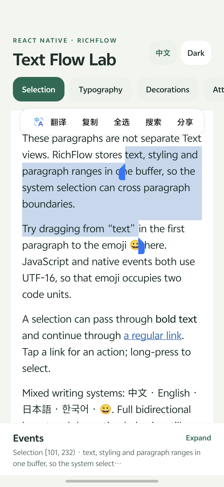
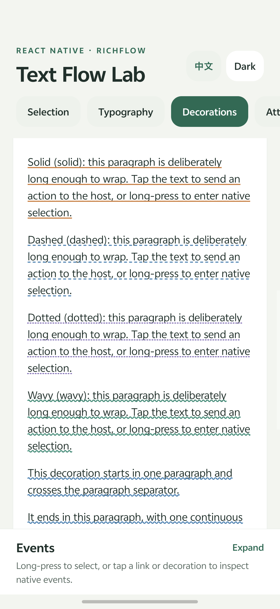
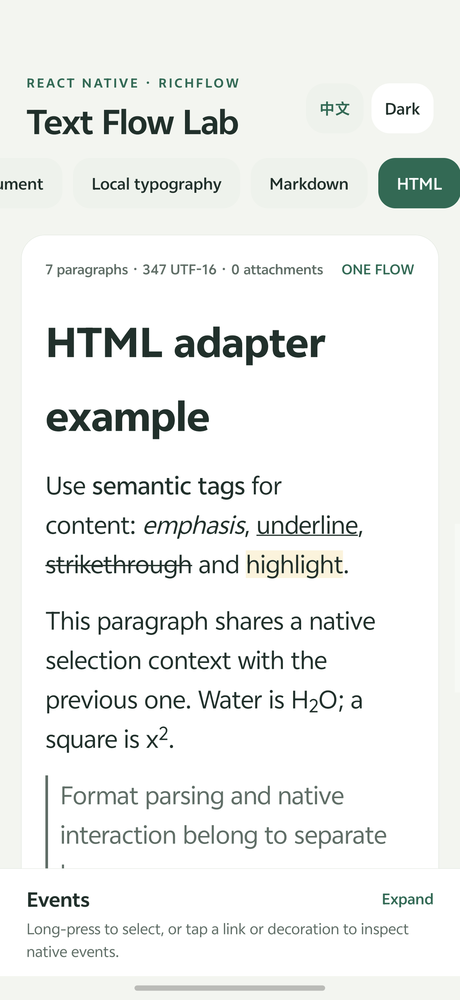
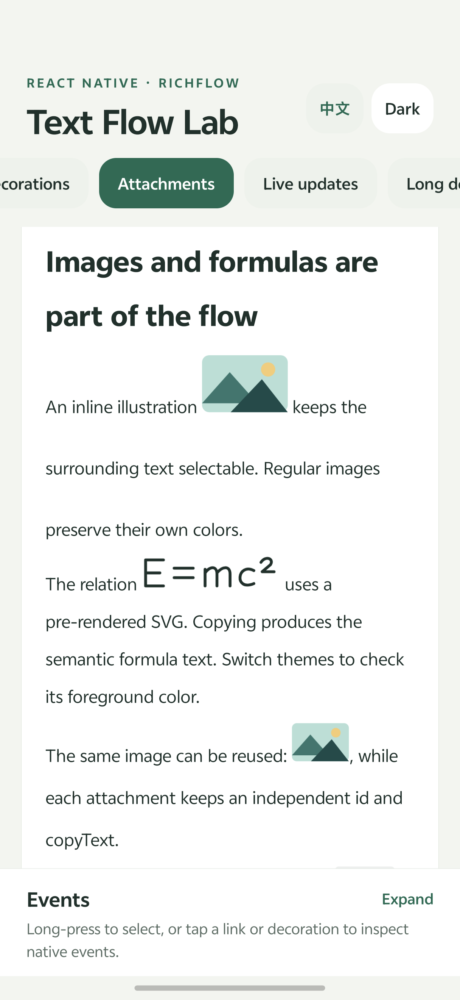
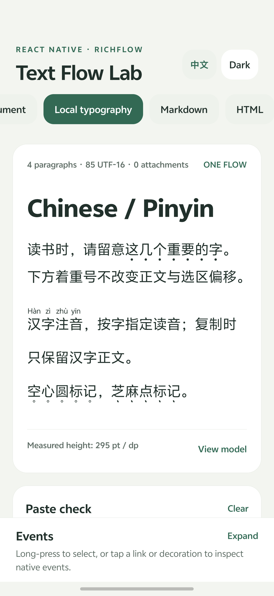
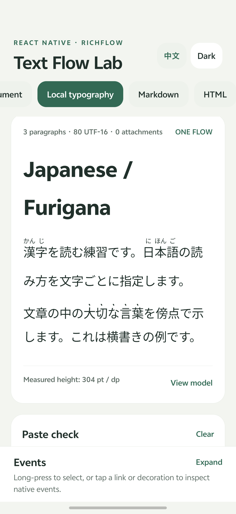

# RichFlow

[简体中文](./README.zh-CN.md)

Native continuous rich text for React Native: one text buffer, paragraph-aware
layout, system selection across paragraphs, custom decorations, and inline
attachments.

RichFlow is a foundation for readers and content renderers. Feed it a typed
semantic document or a compiled flow, and keep navigation, menus, and application
actions in your host app. Markdown and HTML adapters are included as entry points
to the same model.

**Version 0.1.0-alpha.0 is an early preview of the native renderer.** The 0.0.1 API
contains only models and selection utilities; it does not include the native
component shown below. This alpha is intended for integration feedback; its API
and platform behavior may change before a stable release. This repository does
not publish to npm automatically.

## Try the playground

```bash
git clone https://github.com/huamurui/react-native-rich-flow.git
cd react-native-rich-flow
npm ci
npm run check
npm run example:android
# On macOS, alternatively:
npm run example:ios
```

`npm ci` installs the npm workspace and builds the library through `prepare`.
The native run commands generate and build the example host. After installing a
development build, use `npm run example:start` to restart Metro. Android needs
JDK 17 and an Android SDK/device or emulator; iOS needs Xcode and CocoaPods on macOS.

The playground has English and Simplified Chinese UI/content, with nine cases: cross-paragraph selection, text styles,
decorations and actions, inline attachments, content updates, long scrolling,
Markdown, HTML, and language-specific typography. The last case includes Chinese,
Japanese, Zhuyin, Korean, Arabic, French, and English presets. Adjust font size, alignment, theme, and selection; inspect
source mappings and actions; paste system-copied text to check attachment
substitution. Its images and pre-rendered formula SVGs are embedded data URLs.
See the [example guide](./example/README.md) for the interaction checklist.

**Expo Go cannot load RichFlow.** Use a custom [development build](https://docs.expo.dev/develop/development-builds/introduction/).
Web and clients without the module display the supplied `fallback` or an
installation message; they do not receive an equivalent browser renderer.

## Implemented capabilities

These describe the implementation, not a claim of completed device acceptance.
See [native behavior and limits](./docs/native-behavior.md) for platform details.

| Capability | Android | iOS | Boundary |
| --- | --- | --- | --- |
| Continuous text and cross-paragraph system selection | TextView / Spannable | UITextView / TextKit | Within one flow |
| Bold, emphasis, underline, strike, highlight, scripts, code, links | Implemented | Implemented | Semantic styles, not arbitrary CSS |
| Headings, quotes, lists, code blocks, paragraph spacing | Implemented | Implemented | One continuous text layout |
| Solid, dashed, dotted, and wavy range decorations | Implemented | Implemented | Complex bidirectional layout needs testing |
| Character emphasis and horizontal ruby readings | Implemented | Implemented | Independent annotations; original text stays unchanged |
| Language, direction, logical alignment, hyphenation | System layout | System layout | OS-specific shaping and line breaking |
| Inline image and formula-image attachments | Implemented | Implemented | One U+FFFC slot per attachment |
| Semantic copying and selection source mapping | Native copy + JS mapping | Native copy + JS mapping | UTF-16 semantic offsets |
| Asynchronous attachment loading and height updates | Implemented | Implemented | Initial geometry can change after loading |
| Markdown / HTML input | Shared adapter | Shared adapter | Common semantic subset |

Screenshots from the included playground on Android 16 (vivo V2509A), using the
light theme. Tap an image for full resolution. [Capture notes](./docs/images/README.md).

| Cross-paragraph selection | Decorations that wrap with text |
| --- | --- |
| <a href="./docs/images/android-selection.png"></a> | <a href="./docs/images/android-decorations.png"></a> |
| Native selection spans paragraphs within one text flow. | Solid, dashed, dotted, and wavy decorations follow wrapped text. |

## Use in another app

The development baseline is Expo SDK 55, Expo Modules Core 55, React 19.2, and
React Native 0.83.10. Broad peer version ranges are not a compatibility matrix.
Node.js must satisfy the package's `engines` field. An existing bare React Native
app must first [install and configure Expo Modules](https://docs.expo.dev/bare/installing-expo-modules/)
using the instructions appropriate to its React Native / Expo versions.

Install the alpha explicitly:

```bash
npm install react-native-rich-flow@0.1.0-alpha.0
# Or follow the alpha channel: npm install react-native-rich-flow@alpha
```

To test a local checkout instead, build a package:

```bash
# In the library repository:
npm pack

# In a sibling application with Expo Modules already configured:
npm install ../react-native-rich-flow/react-native-rich-flow-0.1.0-alpha.0.tgz
npx expo run:android
# Or: npx expo run:ios
```

The package includes native sources and Expo autolinking metadata. Rebuild the
native application after installing or changing native code. Fast Refresh cannot
add a native module to an existing binary.

## Minimal document → flow → view

```tsx
import { useMemo, useState } from 'react';
import { ScrollView, Text } from 'react-native';
import { compileDocument, type RichFlowDocument } from 'react-native-rich-flow';
import { RichFlow } from 'react-native-rich-flow/native';

const typography = { fontSize: 17, lineHeight: 28, paragraphSpacing: 12 };
const document: RichFlowDocument = {
  id: 'article',
  blocks: [
    {
      id: 'p1',
      type: 'paragraph',
      children: [
        { id: 't1', type: 'text', text: 'Select from this paragraph ' },
        {
          id: 'bold', type: 'strong',
          children: [{ id: 't2', type: 'text', text: 'across the next one.' }],
        },
      ],
    },
    {
      id: 'p2',
      type: 'paragraph',
      children: [{ id: 't3', type: 'text', text: 'The same selection can include 😀.' }],
    },
  ],
};

export default function Reader() {
  const [selectedText, setSelectedText] = useState('');
  const flow = useMemo(() => compileDocument(document, typography), []);

  return (
    <ScrollView contentContainerStyle={{ padding: 20 }}>
      <RichFlow
        flow={flow}
        config={typography}
        selectable
        onSelectionChange={(event) => setSelectedText(event.text)}
      />
      <Text>Selected: {selectedText || 'Long-press the content above.'}</Text>
    </ScrollView>
  );
}
```

Give every document node a unique, nonempty `id`. Treat documents and flows as
immutable. `compileDocument` generates a content revision; if you supply your own
`textVersion`, update it whenever the content changes.

When changing font size, line height, or paragraph spacing, recompile with the
new options **and** pass the same metrics to `RichFlow.config`. Compiled paragraphs
contain explicit metrics; changing only the native config can leave heading and
paragraph metrics out of sync.

`RichFlow` measures its available width and updates its height from native layout.
Use it in a container with a defined available width. An empty flow has zero
content height. It does not scroll internally; the example uses a `ScrollView`.

## Markdown and HTML adapters

```ts
import { compileDocument } from 'react-native-rich-flow';
import { parseHtml, parseMarkdown } from 'react-native-rich-flow/adapters';

const options = { fontSize: 17, lineHeight: 28, paragraphSpacing: 12 };
const markdownFlow = compileDocument(
  parseMarkdown('# Hello\n\nFirst paragraph.\n\n**Second paragraph.**', { id: 'md' }),
  options,
);
const htmlFlow = compileDocument(
  parseHtml('<p>Read <a href="/guide">the guide</a>.</p>', {
    id: 'html', baseUrl: 'https://example.com',
  }),
  options,
);
```

Pass either result to the same `<RichFlow flow={...} config={options} />`.
The adapters preserve common text styles, paragraphs, headings, lists, quotes,
code, links, and images. Tables become textual rows rather than grid layouts.
HTML with `data-latex` can represent a formula; a rendered image source is still
needed to display the formula. Markdown math syntax is not a TeX renderer.

The adapters discard scripts, styles, forms, embedded documents, inline SVG/MathML,
and other unsupported active elements. They filter link/image schemes and can
resolve relative URLs with `baseUrl`. They do not execute HTML, implement a CSS
cascade, or produce sanitized HTML for use in a browser. Link actions are
reported to the host; RichFlow does not automatically navigate.

| HTML → native text | Inline images and formulas |
| --- | --- |
| <a href="./docs/images/android-html.png"></a> | <a href="./docs/images/android-attachments.png"></a> |
| Semantic HTML becomes native headings, emphasis, highlight, and scripts. | Images and pre-rendered formula SVGs participate in the same text layout. |

## Public entry points

| Import | Exports |
| --- | --- |
| `react-native-rich-flow` | `compileDocument`, document/flow types, `isValidTextRange`, `getRichTextSelectionText`, `mapRichTextSelection` |
| `react-native-rich-flow/native` | `RichFlow`, `isRichFlowAvailable`, component/config/event types |
| `react-native-rich-flow/adapters` | `parseMarkdown`, `parseHtml`, `ParseOptions` |

The root entry does not import React Native or the parsers. The native entry needs
the React Native and Expo Modules peers. Parser dependencies are used by the
adapter entry. ESM, CommonJS, and TypeScript declarations are included.

`RichFlow` accepts `flow`, `config`, `selectable`, `suppressDoubleTapSelection`,
`fallback`, regular `ViewProps`, and these callbacks:

- `onSelectionChange`: `flowId`, `textVersion`, UTF-16 `start` / `end`, semantic
  `text`, and `mapping`. Cleared selection is `-1 / -1`, empty text, and `null` mapping.
- `onAction`: `kind` (`link`, `decoration`, `attachment`, `attachmentLongPress`),
  `id`, range, flow identity, and an optional URL. The host decides the action.
- `onHeightChange`: measured content height in React Native layout units.

`RichFlowConfig` contains font size, minimum line height, paragraph spacing,
text/secondary/link colors, `justify`, and `textAlign` (`left`, `center`, `right`,
`start`, `end`). `language` accepts a BCP 47 tag, `writingDirection` is `auto`,
`ltr`, or `rtl`, and `hyphenation` is `none`, `normal`, or `full`.
Use the flow's `decorations` array for custom range decoration styles and actions.
In this alpha, span-level `color` is applied only to highlight backgrounds and
link text; colors on other style spans such as `strong` are ignored.

## Character emphasis and ruby

Use `textEmphasis` for per-character marks and `ruby` for a supplied reading:

```ts
const annotated = compileDocument({
  id: 'reading',
  blocks: [{ id: 'p', type: 'paragraph', children: [{
    id: 'dots', type: 'textEmphasis', mark: 'dot', position: 'under',
    children: [{
      id: 'reading-han', type: 'ruby', annotation: 'hàn',
      children: [{ id: 'han', type: 'text', text: '汉' }],
    }],
  }] }],
});
// annotated.text is '汉'; copying selects the base, not 'hàn'.
```

Marks are `dot`, `circle`, or `sesame`, placed `over` or `under` (default: under).
Italic `emphasis` remains a separate style. Ruby defaults to over and supports
furigana, pinyin, and horizontal Zhuyin. Readings are caller-supplied, not generated.
HTML `<ruby>漢<rt>かん</rt>字<rt>じ</rt></ruby>` maps to the same model;
`rt` and `rp` never enter copied base text. Use `data-ruby-position="under"` or
`data-text-emphasis="sesame" data-emphasis-position="over"` for explicit positioning.

The compiler stores annotations separately in `flow.annotations`. Native layout
reserves vertical space; ruby is fitted to the base width. Prefer one ruby node
per character or reading unit: a wrapped group divides reading graphemes by base
grapheme proportions, without inferring phonetic alignment. Vertical text,
traditional Zhuyin side annotations, automatic readings, and multiple ruby tiers
are not implemented. See [native behavior](./docs/native-behavior.md).

Choose language and writing direction explicitly for each flow. French spacing
comes from the source's nonbreaking spaces; the renderer does not rewrite text.
System Korean word wrapping, Arabic shaping, and Latin hyphenation can differ by OS.

| Chinese: pinyin and emphasis | Japanese: furigana and emphasis |
| --- | --- |
| <a href="./docs/images/android-cjk-pinyin.png"></a> | <a href="./docs/images/android-cjk-furigana.png"></a> |
| Per-character pinyin above the text; dots, circles, and sesame marks below. | Horizontal furigana and sesame emphasis marks above the text. |

## Selection and attachment contracts

`isValidTextRange(text, start, end)` checks a nonempty `[start, end)` range of safe
integer UTF-16 offsets, including surrogate-pair boundaries. It does not enforce
complete grapheme clusters.

`getRichTextSelectionText(flow, start, end)` copies text while replacing valid
single-character U+FFFC attachment slots with `copyText`. Invalid ranges return
an empty string. It does not change the flow or its offsets.

`mapRichTextSelection(flow, start, end)` returns semantic text and source
endpoints `{ nodeId, paragraphId?, offset }`, or `null` for an invalid/unmappable
selection. Generated paragraph separators and list markers are synthetic;
endpoints move inward to real selected content. Source offsets are into decoded
semantic nodes, **not raw Markdown or HTML source positions**.

A `formula` attachment's `latex` is its semantic value. Supply a pre-rendered
image URL or image data URL for visual mathematics. The library contains no TeX
engine. Images and formula images remain part of the same selectable buffer.

## Current limits

Selection across separate native views, arbitrary embedded React components,
editable text, browser CSS/layout, full table layout, and TeX typesetting are out
of scope. The text buffer is not virtualized. Long-document performance,
accessibility, complex bidirectional text, and selection handles require testing
on the devices your application supports. Native builds and model tests do not
replace those interaction checks.

## Development

```bash
npm ci
npm run check
npm run check:package
npm run test:native:ios             # Foundation checks; macOS + Xcode
npm run test:native:ios-layout      # TextKit geometry; boot an iOS simulator first
npm run example:prebuild           # Generates the native example projects
npm run test:native:android         # JVM tests in the generated Android host
npm run test:native:android-layout  # Bitmap regressions; connected Android device/emulator
```

Run commands from the repository root. The repository uses npm workspaces with
one `package-lock.json`; install dependencies there rather than independently in
`example/`. Generated `example/android`, `example/ios`, build outputs, and local
credentials are excluded from version control. See the [example guide](./example/README.md),
[native behavior](./docs/native-behavior.md), [changelog](./CHANGELOG.md), and
[publishing instructions](./PUBLISHING.md).
Recorded local results and remaining device checks are in [validation](./docs/validation.md).

## Origin and license

RichFlow extracts and generalizes native text-flow work from
[zhihu-minus-minus](https://github.com/huamurui/zhihu-minus-minus), with application
routing, authentication, and business actions removed. See [NOTICE](./NOTICE) for
source provenance. RichFlow is licensed under the [MIT License](./LICENSE),
Copyright (c) 2026 huamurui. Dependencies retain their own licenses.
